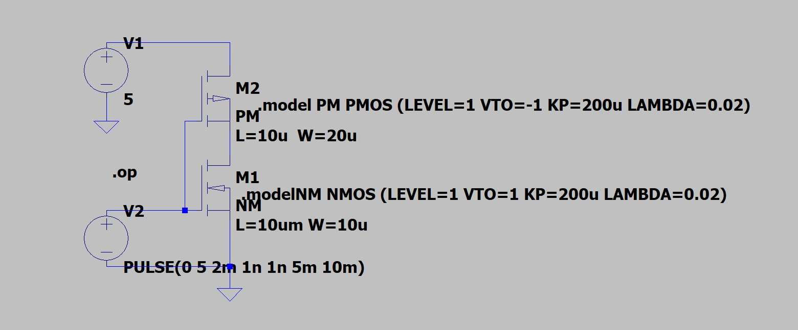
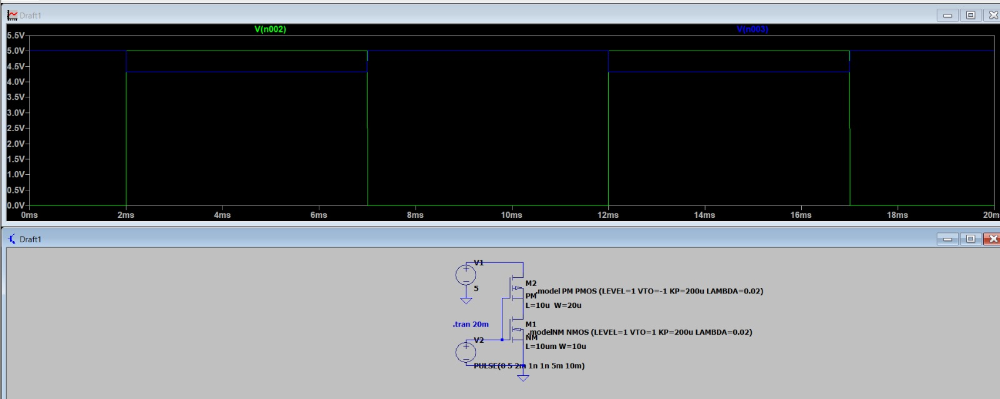
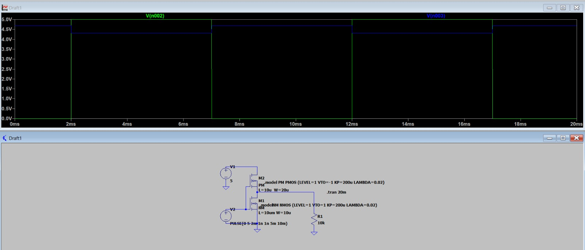
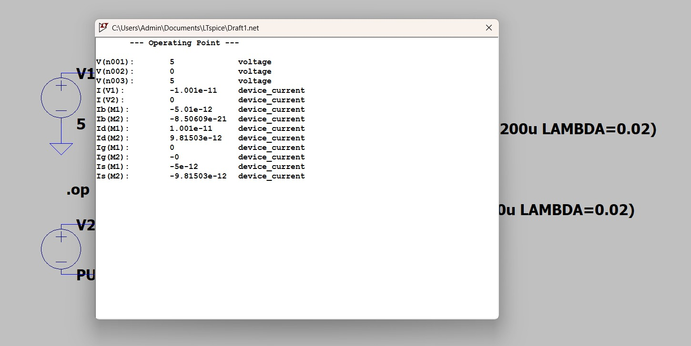

# CMOS Inverter Simulation Using LTspice

## 1. Project overview

This project explores a complementary MOS (CMOS) inverter using an NMOS transistor and a PMOS transistor in LTspice. The circuit was simulated with a pulse input, and the work includes transient waveform observation, a DC operating-point check, and an exploratory AC-analysis setup.

Two output configurations were studied:

- **Unloaded inverter:** no external resistor connected to the output.
- **Loaded inverter:** a 10 kΩ resistor connected between the output and ground.

The purpose of the exercise was to get practical experience building a transistor-level schematic, defining MOSFET models, running different analyses, and interpreting simulation plots.

## 2. Project objectives

- Build a CMOS inverter at transistor level.
- Understand the roles of the PMOS pull-up device and NMOS pull-down device.
- Apply a pulse signal and observe the input/output response over time.
- Compare the circuit with and without a resistive output load.
- Use the DC operating-point report to inspect node voltages and transistor currents.
- Become familiar with transient and AC analysis in LTspice.

## 3. CMOS inverter operation

A CMOS inverter uses two complementary MOSFETs. The PMOS is connected to the positive supply and the NMOS is connected to ground. Their gates share the input, and their drains share the output.

- **Input low:** the PMOS is intended to turn on and pull the output toward VDD, while the NMOS is intended to be off.
- **Input high:** the NMOS is intended to turn on and pull the output toward ground, while the PMOS is intended to be off.

This gives the inverter its logical inversion: a low input should produce a high output, and a high input should produce a low output.

## 4. Circuit specifications

| Parameter | Value |
|---|---|
| Supply voltage (VDD) | 5 V |
| NMOS transistor | M1 |
| NMOS model name | `NM` |
| NMOS dimensions | L = 10 µm, W = 10 µm |
| PMOS transistor | M2 |
| PMOS model name | `PM` |
| PMOS dimensions | L = 10 µm, W = 20 µm |
| Input source | `PULSE(0 5 2m 1n 1n 5m 10m)` |
| Transient command | `.tran 20m` |
| Loaded case | 10 kΩ resistor from output to ground |

## 5. MOSFET model definitions

The circuit used simple Level 1 MOSFET models:

```spice
.model NM NMOS (LEVEL=1 VTO=1 KP=200u LAMBDA=0.02)
.model PM PMOS (LEVEL=1 VTO=-1 KP=200u LAMBDA=0.02)
```

- `VTO` defines the model's threshold voltage.
- `KP` is a model parameter related to MOSFET transconductance strength.
- `LAMBDA` represents channel-length modulation in this simplified model.
- The transistor `L` and `W` values define the channel dimensions used in the schematic.

These are educational models for learning the simulation workflow; they are not a foundry-specific process model.

## 6. Simulation results and diagrams

The images below are the screenshots captured from the LTspice exercise.

### 6.1 CMOS inverter schematic

This schematic shows the complementary NMOS/PMOS arrangement, the 5 V supply, and the pulse source applied to the common gate input. The shared drain connection is the output node.



### 6.2 Transient response without an external load

The unloaded circuit was simulated over 20 ms. The input pulse switches between 0 V and 5 V. The plotted traces allow the input and output to be observed across the switching intervals.



### 6.3 Transient response with a 10 kΩ output load

For the loaded configuration, a 10 kΩ resistor was connected from the output node to ground. This adds a resistive path from the output to ground and provides a second configuration for waveform observation.



### 6.4 DC operating-point report

The operating-point report lists the node voltages and currents calculated by LTspice for the DC bias condition. It is useful for checking the operating state of the circuit independently of the time-varying waveform.



## 7. Transient analysis setup

The input source was configured as:

```spice
PULSE(0 5 2m 1n 1n 5m 10m)
```

The pulse parameters mean:

| Parameter | Value | Meaning |
|---|---:|---|
| Initial voltage | 0 V | Starting input level |
| Pulsed voltage | 5 V | High input level |
| Delay | 2 ms | Time before the first rising edge |
| Rise time | 1 ns | Transition time from low to high |
| Fall time | 1 ns | Transition time from high to low |
| Pulse width | 5 ms | Duration of the high level |
| Period | 10 ms | Time for one complete pulse cycle |

The transient command was:

```spice
.tran 20m
```

This asks LTspice to calculate the time-domain response over a 20 ms interval, allowing the pulse to be observed across multiple transitions.

## 8. Loaded and unloaded comparison

| Feature | Without load | With 10 kΩ load |
|---|---|---|
| Supply voltage | 5 V | 5 V |
| Input signal | 0–5 V pulse | 0–5 V pulse |
| Additional output component | None | 10 kΩ resistor to ground |
| Analysis | Transient | Transient |
| Main learning focus | Observe inverter switching | Observe output with resistive loading |

The two simulations use the same basic inverter and input stimulus. The added resistor changes the output load, which can affect the output voltage and the current demanded from the circuit. This exercise provides a visual comparison of the two configurations; no quantitative delay or power comparison is claimed.

## 9. DC operating-point analysis

The operating-point analysis was run with the input at 0 V. The report showed:

| Measurement | Simulated value |
|---|---:|
| V(n001) | 5 V |
| V(n002) | 0 V |
| V(n003) | 5 V |
| Drain current of M1 | Approximately 1.001 × 10⁻¹¹ A |
| Drain current of M2 | Approximately 9.815 × 10⁻¹² A |

The reported 5 V output for a 0 V input matches the expected high-output state. The operating-point window also provides a useful example of how LTspice reports node voltages and device currents.

## 10. AC analysis

An AC analysis was also explored using a 2.5 V DC input bias, an AC amplitude of 1, and this directive:

```spice
.ac dec 100 1 100Meg
```

AC analysis evaluates a circuit's small-signal response around its DC operating point. The directive requests a logarithmic sweep from 1 Hz to 100 MHz with 100 points per decade. In this project, it was an introductory exploration of the AC-analysis workflow rather than a validated gain or bandwidth measurement.

## 11. Workflow followed

1. Draw the CMOS inverter schematic in LTspice.
2. Connect the PMOS to the positive supply and the NMOS to ground.
3. Connect both gates to the input and both drains to the output.
4. Define the NMOS and PMOS model statements.
5. Apply the pulse source and run transient analysis.
6. Observe the input and output waveforms.
7. Add a 10 kΩ resistor from the output to ground and run the loaded configuration.
8. Run the DC operating-point analysis and inspect the node voltages and transistor currents.
9. Explore the AC-analysis setup.

## 12. Tools and concepts practiced

- **Software:** LTspice
- **Circuit:** CMOS inverter
- **Devices:** NMOS and PMOS MOSFETs
- **Analyses:** Transient, DC operating point, and exploratory AC analysis
- **Concepts:** CMOS switching, transistor-level schematic design, MOSFET model parameters, pulse sources, output loading, and waveform interpretation

## 13. Conclusion

A CMOS inverter was assembled and simulated in LTspice using NMOS and PMOS transistor models. The exercise covered the unloaded circuit, a 10 kΩ-loaded configuration, transient waveforms, and DC operating-point analysis, with an additional exploration of AC analysis. It provided practical experience in constructing a transistor-level circuit, setting up simulation directives, and reading LTspice results.

## Repository contents

- `README.md` — project description, circuit details, analysis setup, and linked results.
- `models/inverter_models.lib` — NMOS and PMOS model definitions.
- `cmos_inverter_schematic.jpg` — schematic screenshot.
- `cmos_inverter_without_load.jpg` — unloaded transient screenshot.
- `cmos_inverter_with_10k_load.jpg` — loaded transient screenshot.
- `dc_operating_point.jpg` — DC operating-point screenshot.
